# ambientCG: Wood materials

**34 assets from [ambientCG](https://ambientcg.com), dedicated to the public domain under [CC0](https://docs.ambientcg.com/license/).** Use them in any game, free or paid, and change them however you like; no credit is needed.

PBR materials as 1K and 2K JPG maps (colour, normal GL and DX, roughness, AO, displacement), one folder per resolution. 873.2 MB in all.

This is a copy kept by [zuujis-cc0](https://github.com/zuujis-cc0) so game makers can take single files from GitHub. It is not made by or affiliated with ambientCG: the originals, often in more formats and higher resolutions, are on [ambientcg.com](https://ambientcg.com). If they help you, consider [supporting ambientCG](https://www.patreon.com/ambientCG).

Every file is listed in [MANIFEST.tsv](MANIFEST.tsv) with its size and SHA-256. More free assets: [the Zuujis collection](https://github.com/zuujis-cc0/free-game-assets#readme).

| | | | |
| :-: | :-: | :-: | :-: |
| <a href="Wood001">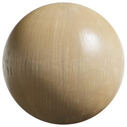</a> <b><a href="Wood001">Wood 001</a></b> by ambientCG · <a href="https://ambientcg.com/a/Wood001">source</a> | <a href="Wood002">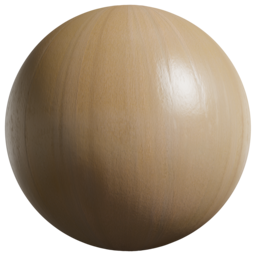</a> <b><a href="Wood002">Wood 002</a></b> by ambientCG · <a href="https://ambientcg.com/a/Wood002">source</a> | <a href="Wood003">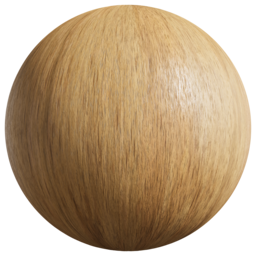</a> <b><a href="Wood003">Wood 003</a></b> by ambientCG · <a href="https://ambientcg.com/a/Wood003">source</a> | <a href="Wood004">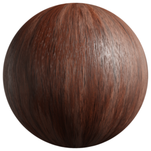</a> <b><a href="Wood004">Wood 004</a></b> by ambientCG · <a href="https://ambientcg.com/a/Wood004">source</a> |
| <a href="Wood005">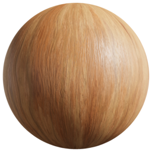</a> <b><a href="Wood005">Wood 005</a></b> by ambientCG · <a href="https://ambientcg.com/a/Wood005">source</a> | <a href="Wood006">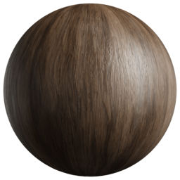</a> <b><a href="Wood006">Wood 006</a></b> by ambientCG · <a href="https://ambientcg.com/a/Wood006">source</a> | <a href="Wood007">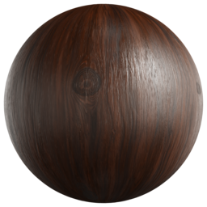</a> <b><a href="Wood007">Wood 007</a></b> by ambientCG · <a href="https://ambientcg.com/a/Wood007">source</a> | <a href="Wood008">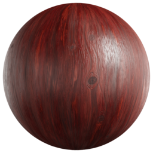</a> <b><a href="Wood008">Wood 008</a></b> by ambientCG · <a href="https://ambientcg.com/a/Wood008">source</a> |
| <a href="Wood009">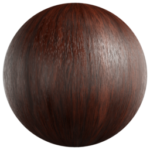</a> <b><a href="Wood009">Wood 009</a></b> by ambientCG · <a href="https://ambientcg.com/a/Wood009">source</a> | <a href="Wood010">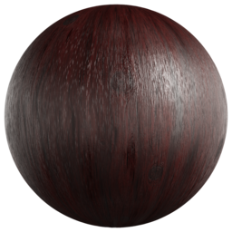</a> <b><a href="Wood010">Wood 010</a></b> by ambientCG · <a href="https://ambientcg.com/a/Wood010">source</a> | <a href="Wood011">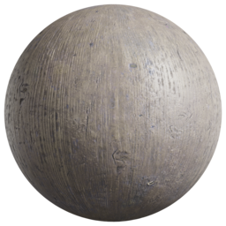</a> <b><a href="Wood011">Wood 011</a></b> by ambientCG · <a href="https://ambientcg.com/a/Wood011">source</a> | <a href="Wood012">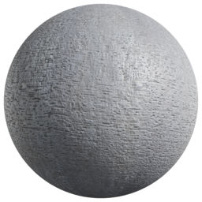</a> <b><a href="Wood012">Wood 012</a></b> by ambientCG · <a href="https://ambientcg.com/a/Wood012">source</a> |
| <a href="Wood013">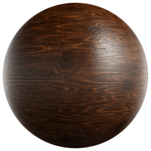</a> <b><a href="Wood013">Wood 013</a></b> by ambientCG · <a href="https://ambientcg.com/a/Wood013">source</a> | <a href="Wood014">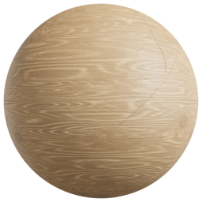</a> <b><a href="Wood014">Wood 014</a></b> by ambientCG · <a href="https://ambientcg.com/a/Wood014">source</a> | <a href="Wood015">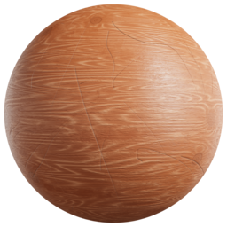</a> <b><a href="Wood015">Wood 015</a></b> by ambientCG · <a href="https://ambientcg.com/a/Wood015">source</a> | <a href="Wood016">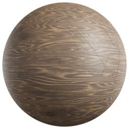</a> <b><a href="Wood016">Wood 016</a></b> by ambientCG · <a href="https://ambientcg.com/a/Wood016">source</a> |
| <a href="Wood017">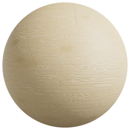</a> <b><a href="Wood017">Wood 017</a></b> by ambientCG · <a href="https://ambientcg.com/a/Wood017">source</a> | <a href="Wood018">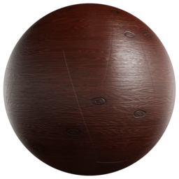</a> <b><a href="Wood018">Wood 018</a></b> by ambientCG · <a href="https://ambientcg.com/a/Wood018">source</a> | <a href="Wood019">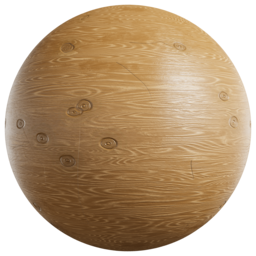</a> <b><a href="Wood019">Wood 019</a></b> by ambientCG · <a href="https://ambientcg.com/a/Wood019">source</a> | <a href="Wood020">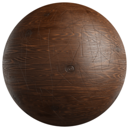</a> <b><a href="Wood020">Wood 020</a></b> by ambientCG · <a href="https://ambientcg.com/a/Wood020">source</a> |
| <a href="Wood021">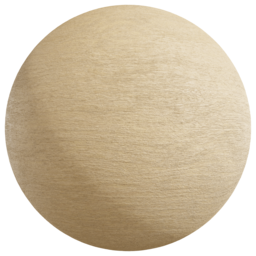</a> <b><a href="Wood021">Wood 021</a></b> by ambientCG · <a href="https://ambientcg.com/a/Wood021">source</a> | <a href="Wood022">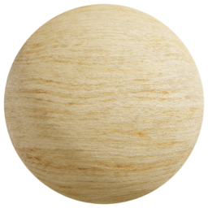</a> <b><a href="Wood022">Wood 022</a></b> by ambientCG · <a href="https://ambientcg.com/a/Wood022">source</a> | <a href="Wood023">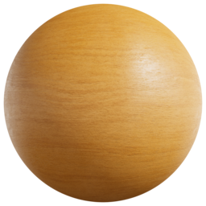</a> <b><a href="Wood023">Wood 023</a></b> by ambientCG · <a href="https://ambientcg.com/a/Wood023">source</a> | <a href="Wood024">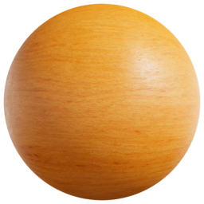</a> <b><a href="Wood024">Wood 024</a></b> by ambientCG · <a href="https://ambientcg.com/a/Wood024">source</a> |
| <a href="Wood025">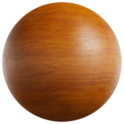</a> <b><a href="Wood025">Wood 025</a></b> by ambientCG · <a href="https://ambientcg.com/a/Wood025">source</a> | <a href="Wood026">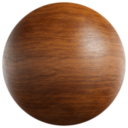</a> <b><a href="Wood026">Wood 026</a></b> by ambientCG · <a href="https://ambientcg.com/a/Wood026">source</a> | <a href="Wood027">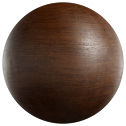</a> <b><a href="Wood027">Wood 027</a></b> by ambientCG · <a href="https://ambientcg.com/a/Wood027">source</a> | <a href="Wood028">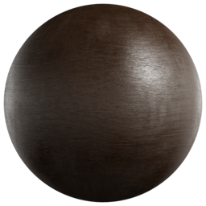</a> <b><a href="Wood028">Wood 028</a></b> by ambientCG · <a href="https://ambientcg.com/a/Wood028">source</a> |
| <a href="Wood029">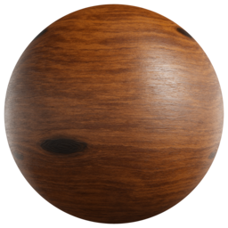</a> <b><a href="Wood029">Wood 029</a></b> by ambientCG · <a href="https://ambientcg.com/a/Wood029">source</a> | <a href="Wood030">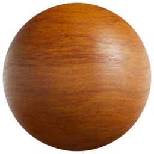</a> <b><a href="Wood030">Wood 030</a></b> by ambientCG · <a href="https://ambientcg.com/a/Wood030">source</a> | <a href="Wood031">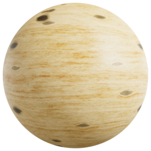</a> <b><a href="Wood031">Wood 031</a></b> by ambientCG · <a href="https://ambientcg.com/a/Wood031">source</a> | <a href="Wood032">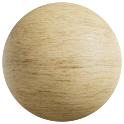</a> <b><a href="Wood032">Wood 032</a></b> by ambientCG · <a href="https://ambientcg.com/a/Wood032">source</a> |
| <a href="Wood033">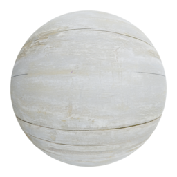</a> <b><a href="Wood033">Wood 033</a></b> by ambientCG · <a href="https://ambientcg.com/a/Wood033">source</a> | <a href="Wood034">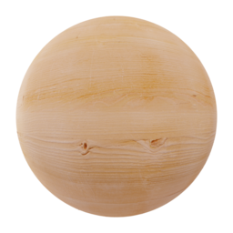</a> <b><a href="Wood034">Wood 034</a></b> by ambientCG · <a href="https://ambientcg.com/a/Wood034">source</a> |  |  |

---

Kept up to date by this repository's own [update workflow](.github/workflows/update.yml), with code and plan from [cc0-mirror](https://github.com/zuujis-cc0/cc0-mirror). Something wrong? [Open an issue there](https://github.com/zuujis-cc0/cc0-mirror/issues/new) or use the [private report form](https://games.zuujis.com/report).
